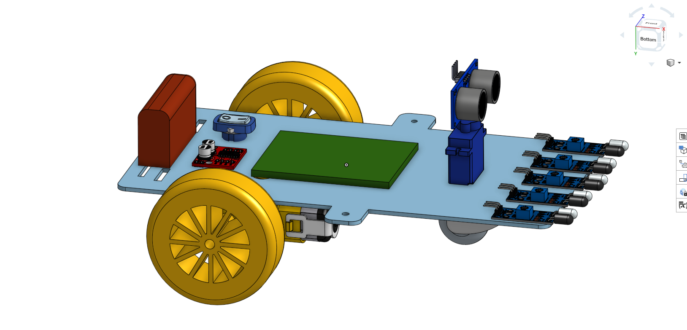
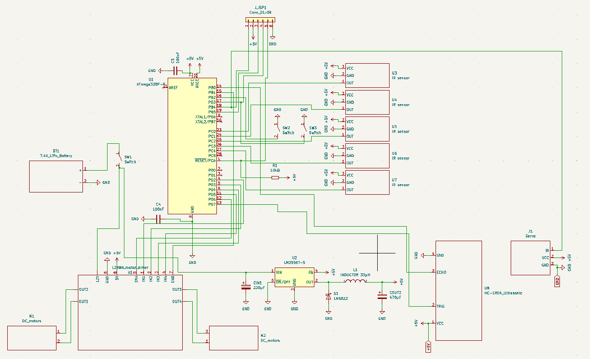
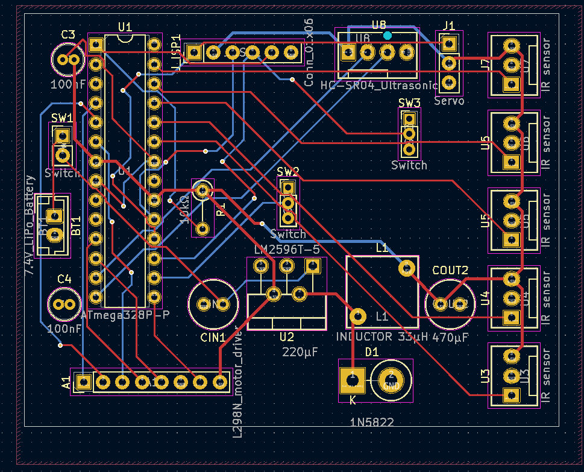

# Robotic-Rover
Its a Robotic Rover with IR sensors and an Ultrasonic sensor, so that it can follow lines and avoid obstacles.

It has an On/Off switch and 2 switches where you can enable and disable the 2 modes line following and obstacle avoidance.

I made it to get started with robotics and hardware but it can be fun to watch.

The step files are the parts I modelled myself for more complex parts I downloaded them on grabcad.

3D design:

Schematic:

PCB design:

